1. Schritt: GCP-Projekt & Tools einrichten:

   Free Trial aktiviert, Projekt `m300-gitea` erstellt und die benötigten API's aktiviert (Compute Engine, Kubernetes Engine, Cloud DNS, Filestore). Lokal habe ich: gcloud CLI, Terraform, kubectl, Helm installliert. Bei GCP authentifiziert.

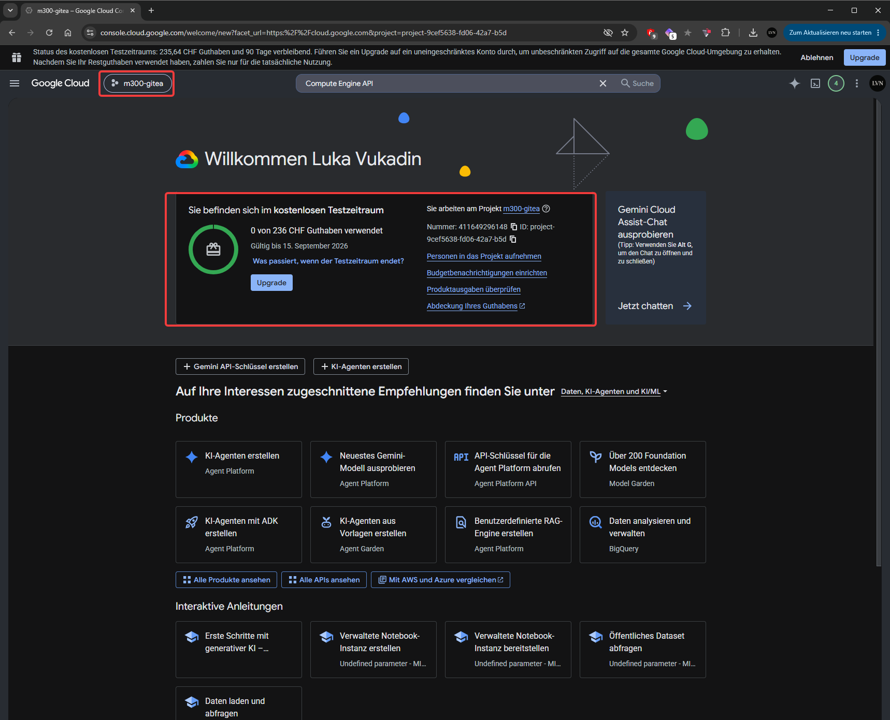

----
2. Schritt: Terraform-Infrastruktur geschrieben:

    Drei Terraform-Files erstellt (`main.tf`, `variables.tf`, `outputs.tf`) die folgende Ressourcen definieren: VPC-Netzwerk, Subnetz mit sekundären IP-Bereichen für Pods/Services, GKE-Cluster, Node-Pool, Cloud DNS Zone, Filestore-Instanz.
    [Hier geht es zu den Files](files/)

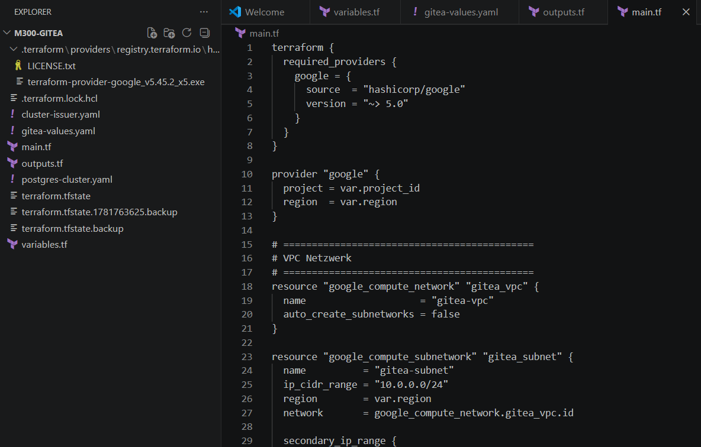

----
3. Schritt: Terraform Apply (mit Problemlösung)

Ich habe `terraform init` und `terraform apply` ausgeführt. Aufgetretene Probleme: fehlende API-Aktivierung im richtigen Projekt, SSD-Quota-Limit überschritten (Lösung: Wechsel von regionalem zu zonalem Cluster):

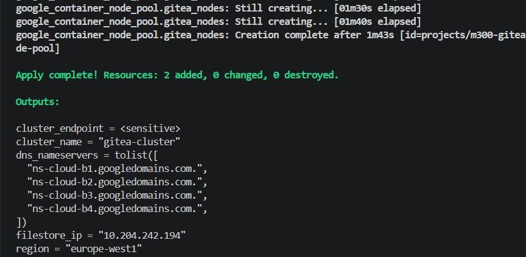

----
4. Schritt: kubectl mit GKE-Cluster verbunden
`gcloud container clusters get-credentials` ausgeführt. Aufgetretenes Problem: TLS-Zertifikatsfehler durch Schul-Netzwerk/Proxy. Ich konnte es lösen indem ich auf Mobile-Hotspot gewechselt habe:

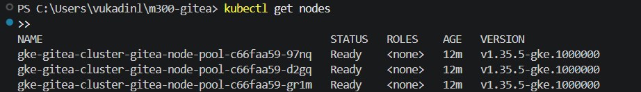

---
5. Schritt: Nginx Ingress Controller installiert

Via Helm installiert (`ingress-nginx` Chart). Erstellt automatisch einen GCP Load Balancer mit öffentlicher IP-Adresse:

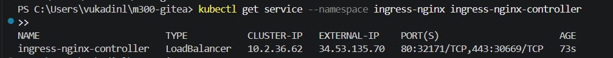
   
---

6. Schritt: cert-manager installiert + ClusterIssuer konfiguriert

cert-manager via Helm installiert für automatische TLS-Zertifikate. `ClusterIssuer` für Let's Encrypt erstellt (`letsencrypt-prod`):

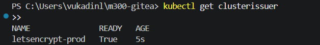

-----

7. Schritt: DNS konfiguriert

Bei Hostpoint einen A-Record erstellt: `git.lukavukadin.ch` → `34.53.135.70`:

---
8. Schritt: Filestore CSI Driver aktiviert

Ursprünglicher Gitea-Helm-Install schlug fehl wegen fehlender `ReadWriteMany`-StorageClass. Filestore-CSI-Driver auf dem Cluster aktiviert (`gcloud container clusters update --update-addons=GcpFilestoreCsiDriver=ENABLED`), wodurch `standard-rwx` StorageClass verfügbar wurde.

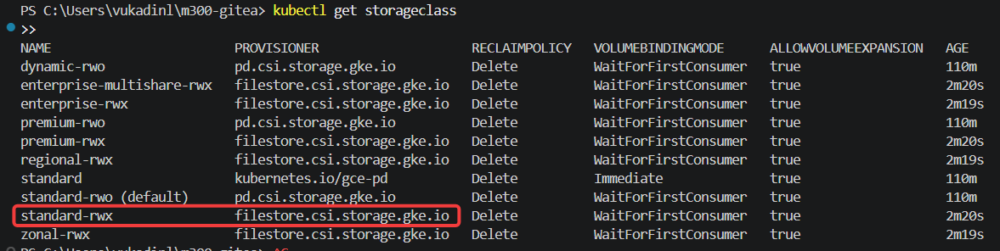

----
9. Schritt: PostgreSQL-Cluster (CloudNativePG) installiert

CloudNativePG Operator via Helm installiert. PostgreSQL-Cluster mit 1 Primary + 2 Replicas erstellt (`postgres-cluster.yaml`):

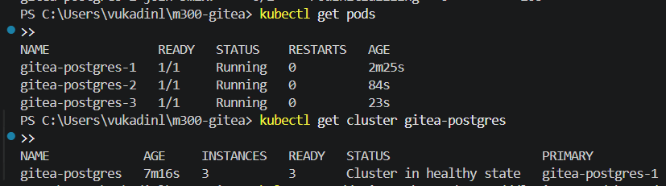

---

10. Schritt: Gitea via Helm installiert - Filestore-Mount-Problem gelöst
   
   Gitea-Konfiguration (`gitea-values.yaml`) erstellt, mit Verbindung zu PostgreSQL und TLS via cert-manager. Beim ersten Deployment blieben die Pods tagelang bei `Init:0/3` hängen, mit dem Fehler `MountVolume.MountDevice failed: DeadlineExceeded`. Das war ein bekannter Bug im Filestore-CSI-Treiber – der Mount blockierte dauerhaft auf Node-Ebene, selbst ein Node-Replace half nicht. Gelöst habe ich es, indem ich statt eines neuen automatisch erstellten Volumes das bereits stabile Filestore-Volume aus Terraform manuell als PersistentVolume eingebunden habe.
   
`Hier sieht man die Drei Gitea-Pods am fest hängen:`
   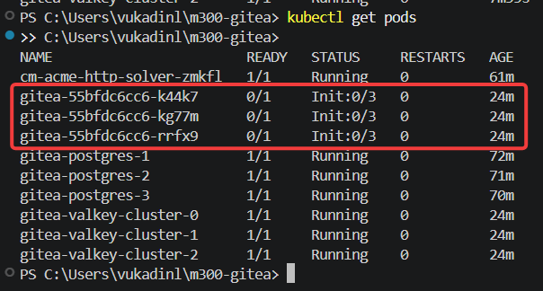
   
`Fehler beim Mounten:`
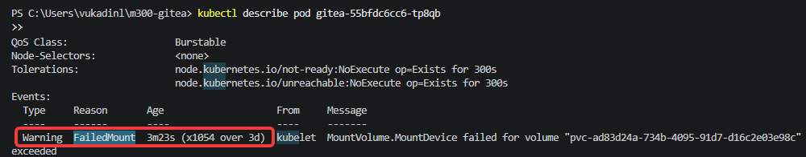

`Lösung: ~gitea-shared-storage erfolgreich gebunden (RWX, standard-rwx):`
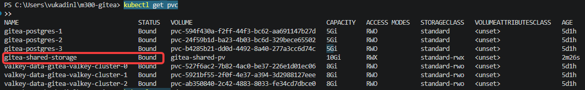

----

11. Schritt: PVC-Konflikt und hängender Finalizer behoben

Beim manuellen Einbinden des PersistentVolumes gab es gleich zwei Folgefehler: Helm wollte das PVC nicht übernehmen (fehlende Ownership-Labels), und die Grösse passte nicht zur Helm-Konfiguration. Nach der Korrektur blieb das PVC dann im Status `Terminating` stecken - das liess sich nur lösen, indem ich den Kubernetes-Finalizer manuell per Patch entfernt habe.

- `PV/PVC manuell erstellt als Workaround:`					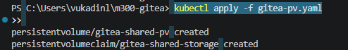

- `Helm-Konflikt mit dem manuellen PVC`	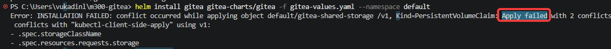

- `Lösung: Patch behebt den Konflikt, Volume wieder frei:`	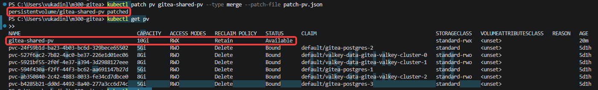

----

12. Schritt: Datenbank-Passwort-Mismatch behoben

